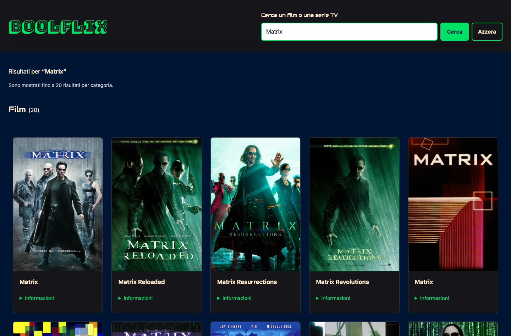

# Boolflix

A Vue application for searching films and TV series in The Movie Database (TMDb) catalogue, built as an individual project during the Boolean programme in **December 2023**. The work focuses on HTTP requests, shared state and presenting results through reusable components.

**[Open the demo](https://massimoperuga.dev/en/demo/boolflix)** · [Project in my portfolio](https://massimoperuga.dev/en/formazione/boolean#boolflix) · [Italiano](README.md)

The [original assignment and exercise documentation](CONSEGNA.md), in Italian, is preserved in full, including milestones and the planning diagram.

## What it includes

- Title search, with parallel film and TV requests and results displayed in separate sections.
- Cards with posters, titles, original titles, languages and star ratings; details appear on hover.
- Flags for Italian and English, codes for other languages and a message when a poster is missing.

## My work

I connected the search form to TMDb’s APIs and organised the results in a reactive store shared by the header and main content. I separated card presentation from title information, passing data through props and converting ratings to a five-star scale.

## Stack and technical choices

| Area | Technologies |
| --- | --- |
| Interface and state | Vue 3, JavaScript, HTML |
| HTTP requests | Axios, TMDb API |
| Styles and layout | Sass/SCSS, Bootstrap 5 |
| Development and build | Vite 5 |

- **Parallel requests:** `Promise.all` coordinates both responses before updating the film and TV lists.
- **Reactive store:** search parameters and results are shared between components without duplicating state.
- **Reusable cards:** films and series pass their respective fields to the same component; a dedicated component presents the details.

Code entry points: [search](src/components/AppHeaderInput.vue), [store](src/assets/js/_partials/_store.js), [results](src/components/AppMain.vue) and [card details](src/components/CardInfoComponent.vue).

## Running locally

You need **Node.js 22 and npm**. The [setup guide](docs/SETUP.en.md) covers preparation, startup, build and preview, including the configuration without an API key used to explore the local interface.

Installation and build were checked with Node.js 22.22.0 and npm 10.9.4. Chrome checks of local search used intercepted responses, without real TMDb requests or credentials.

## Original project and portfolio demo

The original project sends TMDb requests from the browser. For live searches, the portfolio demo uses a server proxy that keeps the credential on the backend.

The demo adds an Italian/English interface, loading, empty and error/retry states, handling of concurrent searches, and details accessible by keyboard and touch. These changes live in the [portfolio adaptations](https://github.com/MassimoPeruga/portfolio/tree/production/site/demos), separately from this repository’s sources. The screenshot shows this integrated version.
