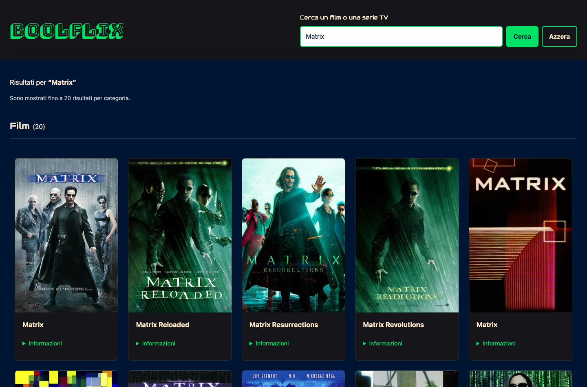

# Boolflix

Applicazione Vue per cercare film e serie TV nel catalogo di The Movie Database (TMDb), realizzata come progetto individuale del percorso Boolean nel **dicembre 2023**. Il lavoro si concentra su richieste HTTP, stato condiviso e presentazione dei risultati attraverso componenti riutilizzabili.

**[Apri la demo](https://massimoperuga.dev/demo/boolflix)** · [Il progetto nel portfolio](https://massimoperuga.dev/formazione/boolean#boolflix) · [English](README.en.md)

La [consegna e documentazione originale dell’esercizio](CONSEGNA.md) è conservata integralmente, con milestone e schema di progettazione.

## Cosa include

- Ricerca per titolo, con richieste parallele a film e serie TV e risultati in sezioni separate.
- Schede con locandina, titolo, titolo originale, lingua e valutazione in stelle; dettagli visibili al passaggio del mouse.
- Bandiere per italiano e inglese, codice per le altre lingue e messaggio quando manca la locandina.

## Il mio lavoro

Ho collegato il modulo di ricerca alle API TMDb e organizzato i risultati in uno store reattivo condiviso tra header e contenuto principale. Ho separato la presentazione della scheda dalle informazioni del titolo, passando i dati tramite props e convertendo il voto in una scala di cinque stelle.

## Stack e scelte tecniche

| Ambito | Tecnologie |
| --- | --- |
| Interfaccia e stato | Vue 3, JavaScript, HTML |
| Richieste HTTP | Axios, API TMDb |
| Stili e layout | Sass/SCSS, Bootstrap 5 |
| Sviluppo e build | Vite 5 |

- **Richieste parallele:** `Promise.all` coordina le due risposte prima di aggiornare gli elenchi di film e serie.
- **Store reattivo:** ricerca e risultati sono condivisi tra componenti senza duplicare lo stato.
- **Schede riutilizzabili:** film e serie passano i rispettivi campi allo stesso componente; un componente dedicato presenta i dettagli.

Punti d’ingresso: [ricerca](src/components/AppHeaderInput.vue), [store](src/assets/js/_partials/_store.js), [risultati](src/components/AppMain.vue) e [dettagli della scheda](src/components/CardInfoComponent.vue).

## Avvio locale

Servono **Node.js 22 e npm**. La [guida di avvio](docs/SETUP.it.md) descrive preparazione, avvio, build e preview, inclusa la configurazione senza chiave usata per esplorare l’interfaccia locale.

Installazione e build sono state verificate con Node.js 22.22.0 e npm 10.9.4. I controlli Chrome sulla ricerca locale hanno usato risposte intercettate, senza chiamate o credenziali TMDb reali.

## Progetto originale e demo del portfolio

Il progetto originale effettua le richieste TMDb dal browser. Per la ricerca reale, la demo del portfolio usa un proxy server che conserva la credenziale sul backend.

La demo aggiunge interfaccia IT/EN, stati di caricamento, nessun risultato ed errore con nuovo tentativo, gestione delle ricerche concorrenti e dettagli utilizzabili anche da tastiera e touch. Questi interventi risiedono negli [adattamenti del portfolio](https://github.com/MassimoPeruga/portfolio/tree/production/site/demos), separati dai sorgenti di questa repository. Lo screenshot mostra questa versione integrata.
